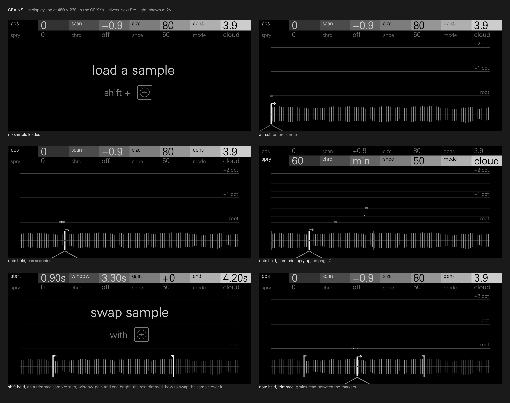

# Grains

A granular sample synth for the OP-XY. Load a sample and play it across the
keyboard: grains read around a position that can scan through it, stack into
chords and spread across the stereo field, and the screen shows each grain
where it reads and at what pitch.



**Status: experimental.** Grains plays on an OP-XY running OS 1.2.1 and targets
Open-XY SDK 1.8. Its render callback last measured 3.105% of the stock block
budget on the device (v1.0.0, median of 3 runs of `opxy-sample-callback-v1`,
graphics excluded). That measures its defaults only, so a preset or setting with
more grains, `dens` up to 20 for example, costs more, and it isn't total device
CPU or a worst-case sweep.

## Playing it

Choose **Grains** on an instrument track, then load a sample (Shift + the
Sample key). One sample plays across the keyboard, as on the stock sampler:
the sample's root key plays it as recorded. Grains reads the whole sample:
pos, scan and spry choose where its grains read, so it needs no trim.

| Page 1 | | Page 2 | |
| --- | --- | --- | --- |
| **pos** | where grains read | **spry** | how random each grain is: where it starts around pos, then its stereo spread, reversing some, and past halfway its pitch and length |
| **scan** | how fast pos moves on: either way, up to 2x; the middle freezes it | **chrd** | off, a detune, or grains stacked on octaves, fifths, a major or minor chord, or harmonics |
| **size** | each grain's length, 10 ms to 2 s | **shpe** | each grain's window, from a swell through smooth to a pluck; the screen draws it under pos |
| **dens** | how many grains overlap, 1 to 20 (in sync mode, the division) | **mode** | cloud (random), sync (on the tempo's divisions) or osc (evenly overlapped); rcld, rsync and rosc play every grain backwards |

Press any encoder to switch pages; Shift + turn makes fine steps. The OP-XY's
own envelopes, LFOs, filter and effects apply as for any instrument.

Every note of Grains, on every track, shares 64 grains at once, to keep its
processing in bounds. Notes take what dens asks for while there's room: three
notes at 20, or eight at 8. Past that, each note gets its part of the 64, in
proportion to what it asks for: fewer grains at once in cloud and osc, shorter
ones on the same beat in sync. A note that has to give grains up fades them
out over about 6 ms. Each grain's level is set as it starts, so fewer grains
play louder without the ones already sounding jumping. The screen still shows
dens's own count.

## Presets

Six presets, each made to play on whatever sample is loaded:

| Preset | What it is | How it's set |
| --- | --- | --- |
| **still** | a frozen cloud, a sound held in place | cloud, no scan, grains of 420 ms, detuned |
| **drift** | a pad that wanders slowly through the sample | cloud, slow scan, long grains, octaves |
| **choir** | each note a major chord | cloud, grains of 240 ms, stacked and spread |
| **stutter** | sixteenths on the tempo | sync, short plucked grains |
| **reed** | a pitched, steady tone from one spot | osc, grains of 28 ms, octaves |
| **undertow** | the sample backwards, swelling | rcloud, slow backward scan, fifths |

Where the sample's own character sits matters most, so try `pos` first.

## The SDK it needs

Grains is a sample engine on the stock sample page (page 2) that plays like the
sampler and draws its own screen, using [Open-XY](https://github.com/etcetc000/open-xy)
SDK 1.8's sample engines with their own screen and the sample's overview:

```sh
git clone -b staging https://github.com/etcetc000/open-xy ../open-xy
python ../open-xy/sdk.py test --machine . --cxx clang++ --host-cxx g++
python ../open-xy/sdk.py build --machine . --stock-os <your stock-1.2.1>/os.ldr --out <folder outside this checkout>
```

Then install the build's `candidate/` files as the SDK's
[build guide](https://github.com/etcetc000/open-xy/blob/staging/docs/build.md#5-install)
describes. Command-line builds carry no presets; the OP-XY lists Grains once
`content/presets/grains/` holds one, and this repository's are in `presets/`.

## Develop

- `sample.cpp`: the grain engine, fixed point, with its tables in `tables.h`
  (`tools/gen_tables.py` writes them).
- `display.cpp`: the screen ([docs/SCREEN.md](docs/SCREEN.md)), its artwork in
  `panel.svg.fragment` (`tools/make_panel.py` writes it).
- `tests/sound.cpp`: the engine's sound tests, which `sdk.py test` runs.

Sample engines have no browser preview of their own. `docs/screen/preview.png`
was rendered by running `display.cpp` through a stand-in synth with the same
screen in the SDK's preview, at the OP-XY's 480 × 220 and in its screen font,
Univers Next Pro Light
([mmockett/OP-XY's renderer](https://github.com/mmockett/OP-XY/tree/main/tools/render)). Agent instructions are in [AGENTS.md](AGENTS.md).

## Licence

MIT ([LICENSE](LICENSE)). Grains takes ideas, not code, from
[Oi, Grandad!](https://github.com/publicsamples/Oi-Grandad) and Elektron's
Tonverk Grainer.
