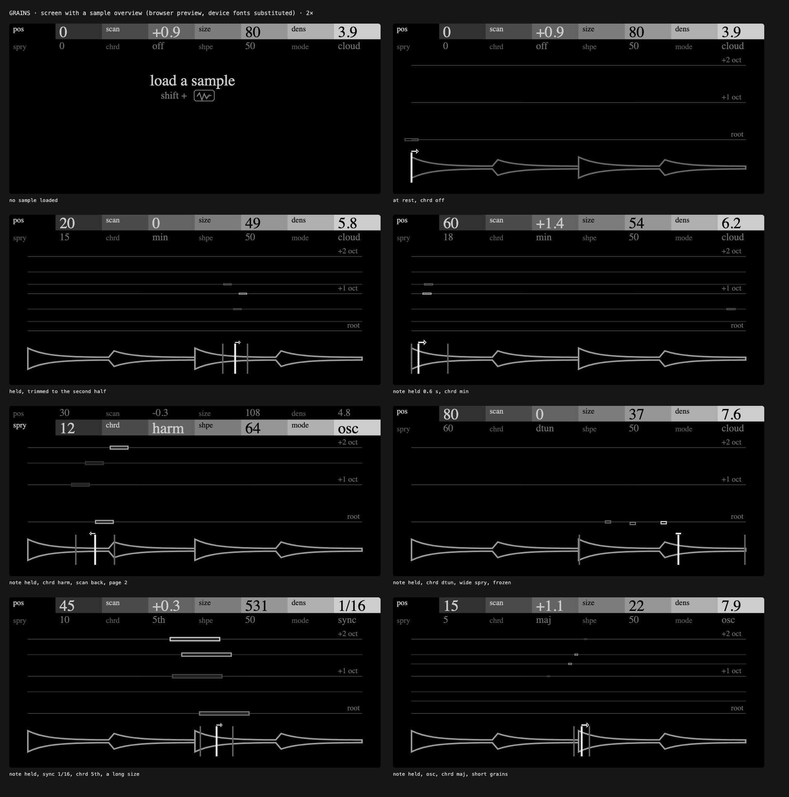

# Grains

A granular sample synth for the OP-XY. Load a sample and play it across the
keyboard: grains read around a position that can scan through it, stack into
chords and spread across the stereo field, and the screen shows each grain
where it reads and at what pitch.



**Status: experimental.** Grains plays on an OP-XY running OS 1.2.1, but it
needs SDK features that aren't in Open-XY yet (below), so it isn't in the
open-xy.com catalog. Its CPU cost hasn't been measured on the device yet.

## Playing it

Choose **Grains** on an instrument track, then load a sample (Shift + the
Sample key). One sample plays across the keyboard, as on the stock sampler:
the sample's root key plays it as recorded. Grains reads the whole sample:
pos, scan and spry choose where its grains read, so it needs no trim.

| Page 1 | | Page 2 | |
| --- | --- | --- | --- |
| **pos** | where grains read | **spry** | how random each grain is: where it starts around pos, then its stereo spread, reversing some, and past halfway its pitch and length |
| **scan** | how fast pos moves on: either way, up to 2x; the middle freezes it | **chrd** | off, a detune, or grains stacked on octaves, fifths, a major or minor chord, or harmonics |
| **size** | each grain's length, 10 ms to 2 s | **shpe** | each grain's window, from a swell through smooth to a pluck |
| **dens** | how many grains overlap, 1 to 20 (in sync mode, the division) | **mode** | cloud (random), sync (on the tempo's divisions) or osc (evenly overlapped); rcloud, rsync and rosc play every grain backwards |

Press any encoder to switch pages; Shift + turn makes fine steps. The OP-XY's
own envelopes, LFOs, filter and effects apply as for any instrument.

Every note of Grains, on every track, shares 64 grains at once, to keep its
processing in bounds. Notes take what dens asks for while there's room: three
notes at 20, or eight at 8. Past that, each note gets its part of the 64, in
proportion to what it asks for: fewer grains at once in cloud and osc, shorter
ones on the same beat in sync. A note that has to give grains up fades them
out over about 6 ms. Each grain's level is set as it starts, so fewer grains
play louder without the ones already sounding jumping. The screen still shows
dens's own count.

## The SDK it needs

Grains is a sample engine on the stock sample page (page 2) that plays like the
sampler and draws its own screen. Three changes to the
[Open-XY SDK](https://github.com/etcetc000/open-xy) make that possible:

1. sample engines on the sampler page, playing one sample chromatically
   ([#180](https://github.com/etcetc000/open-xy/pull/180));
2. sample engines with their own screen, the encoders on their own controls
   ([#181](https://github.com/etcetc000/open-xy/pull/181));
3. the sample's overview for that screen
   ([#182](https://github.com/etcetc000/open-xy/pull/182)).

They're open as pull requests to `etcetc000/open-xy`. Until they merge,
build Grains with [mmockett/open-xy](https://github.com/mmockett/open-xy) on
`sdk/sample-overview`, the branch that holds all three, checked out beside this
repository as `../open-xy`:

```sh
git clone -b sdk/sample-overview https://github.com/mmockett/open-xy ../open-xy
python ../open-xy/sdk.py test --machine . --cxx clang++ --host-cxx g++
python ../open-xy/sdk.py build --machine . --stock-os <your stock-1.2.1>/os.ldr --out <folder outside this checkout>
```

Then install the build's `candidate/` files as the SDK's
[build guide](https://github.com/etcetc000/open-xy/blob/staging/docs/build.md#5-install)
describes. Command-line builds carry no presets; the OP-XY lists Grains once
`content/presets/grains/` holds one.

## Develop

- `sample.cpp`: the grain engine, fixed point, with its tables in `tables.h`
  (`tools/gen_tables.py` writes them).
- `display.cpp`: the screen ([docs/SCREEN.md](docs/SCREEN.md)), its artwork in
  `panel.svg.fragment` (`tools/make_panel.py` writes it).
- `tests/sound.cpp`: the engine's sound tests, which `sdk.py test` runs.

Sample engines have no browser preview of their own. `docs/screen/preview.png`
was rendered by running `display.cpp` through a throwaway synth with the same
screen in the SDK's preview. Agent instructions are in [AGENTS.md](AGENTS.md).

## Licence

MIT ([LICENSE](LICENSE)). Grains takes ideas, not code, from
[Oi, Grandad!](https://github.com/publicsamples/Oi-Grandad) and Elektron's
Tonverk Grainer.
